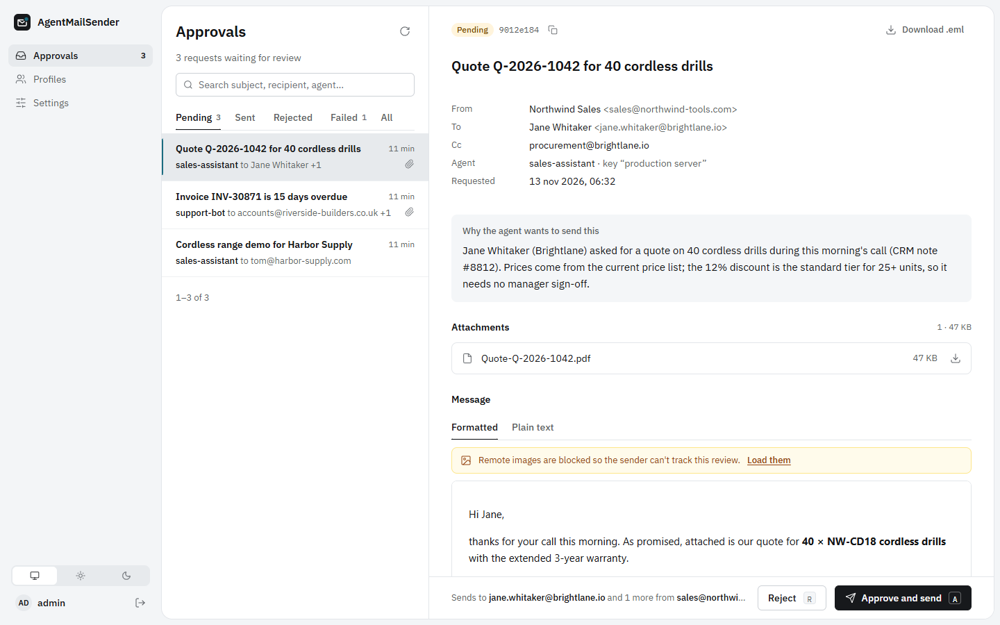
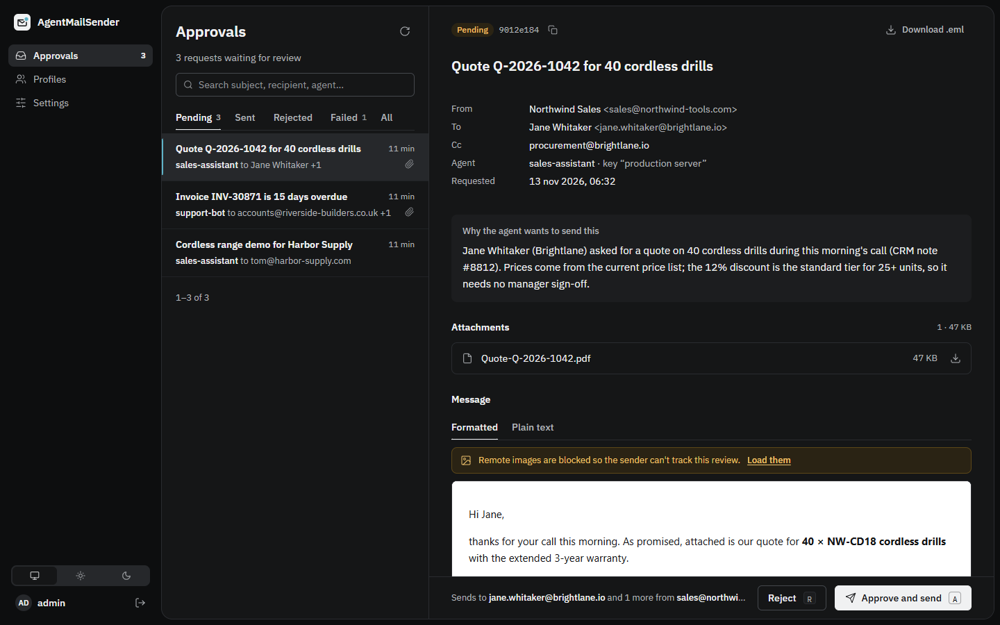
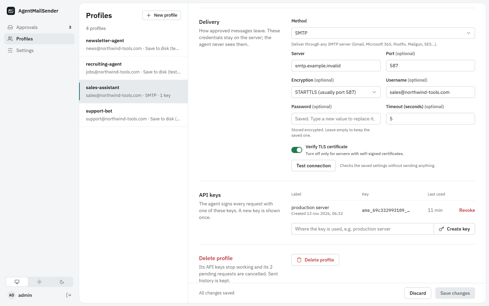

# AgentMailSender

A human review gate for e-mail written by AI agents. Agents submit e-mails through an API; nothing leaves
until an operator has read the message, together with the agent's reason for sending it, and approved it
in a web dashboard.



## How it works

```
agent ──(1) e-mail + reason──▶ AgentMailSender ──(2) notify──▶ Discord · Slack · Telegram · ntfy · webhook
  ▲         (API key)                 │
  │                                   ▼
  │                       (3) operator reviews in the dashboard
  │                                   │
  │                  approve ─────────┴───────── reject + reason
  │                     │                              │
  │                     ▼                              │
  │      profile's SMTP account ──▶ recipient          │
  │                     │                              │
  └──(4) status + reason via API or webhook ◀──────────┘
```

1. Each agent has a **profile** with its own API key, the sender addresses it may use, its signatures and
   the mail account that delivers its messages. The agent never sees that account's credentials.
2. The agent submits an e-mail and a **comment** explaining why it should be sent. The request is stored
   as `pending` and operators are notified.
3. An operator reviews it in the dashboard and either **approves** it (it is delivered at once) or
   **rejects** it with a reason.
4. The agent reads the outcome, and the reason, from the API (or from a webhook) and can submit a revised
   version that supersedes the original.

## Features

- **Agent API** with per-profile API keys, idempotency keys, Cc/Bcc/Reply-To, sender aliases,
  signatures, attachments and inline images, threading headers and free-form metadata.
- **Feedback loop**: agents can poll status or list changes since a timestamp, read the operator's
  reason for a rejection, withdraw requests and submit revisions that supersede earlier ones.
- **Review dashboard** in an inbox layout: status tabs with counts, search, a reading pane with the
  agent's note, attachments, a sandboxed HTML preview and the request's history. The decision bar stays
  in view while you scroll. Keyboard shortcuts, light and dark themes, and a phone layout are included.
- **Safe preview**: the message body renders in a sandboxed frame with scripts disabled. Remote images
  (tracking pixels) are blocked until you choose to load them. You can download the exact `.eml` that
  will be sent.
- **Profiles**: multiple sender identities, signatures (plain and HTML) applied before review, a
  default Reply-To, SMTP delivery with a connection test, multiple API keys per profile with revocation.
- **Notifications**: Discord, Slack (and Mattermost), Telegram, ntfy and generic webhooks, which can be
  HMAC-signed or use custom body templates. Each channel can be filtered by event and by profile, and its
  links open the request in your dashboard.
- **Extensible**: delivery methods and notification channels are plugins that describe their own
  settings. The UI renders their forms automatically.
- **Small footprint**: one Python process, SQLite and a no-build web UI. Fonts are bundled, so nothing
  is loaded from third-party CDNs.

<p>
  
  
</p>

## Quick start

### With Docker

```bash
cp .env.example .env          # optional: set AMS_ADMIN_PASSWORD, AMS_SECRET_KEY, AMS_PUBLIC_URL
docker compose up -d
docker compose logs agentmailsender   # shows the generated admin password if you didn't set one
```

Open <http://localhost:8080> and sign in. Data (database, attachments, encryption key) lives in the
`ams-data` volume.

### On Proxmox VE (LXC container)

Run this in the shell of a Proxmox VE 8 or 9 host, as root:

```bash
bash -c "$(curl -fsSL https://raw.githubusercontent.com/KorinBlack/AgentMailSender/main/deploy/proxmox/create-ct.sh)"
```

The script shows a summary and asks for confirmation. Then it:

1. downloads the latest Debian template (Debian 13 on Proxmox VE 9, Debian 12 on 8);
2. creates an unprivileged container with nesting enabled: 1 core, 512 MB RAM, 4 GB disk, DHCP on
   `vmbr0`, started at boot;
3. installs AgentMailSender inside it as a systemd service on port 8080, with a generated encryption key;
4. prints the dashboard URL and the admin password. The password is also saved in
   `/root/agentmailsender-credentials.txt` inside the container; delete that file after you sign in.

Pass options after a `_`, for example a static address on another storage:

```bash
bash -c "$(curl -fsSL https://raw.githubusercontent.com/KorinBlack/AgentMailSender/main/deploy/proxmox/create-ct.sh)" _ \
  --ctid 210 --ip 192.168.1.50/24 --gateway 192.168.1.1 --storage local-zfs
```

| Option | Default |
| --- | --- |
| `--ctid` | next free ID |
| `--hostname` | `agentmailsender` |
| `--storage`, `--disk` (GB) | `local-lvm` (or `local-zfs`), 4 |
| `--cores`, `--memory`, `--swap` (MB) | 1, 512, 512 |
| `--bridge`, `--ip`, `--gateway`, `--vlan`, `--nameserver` | `vmbr0`, `dhcp` |
| `--debian` | 13 on Proxmox VE 9, else 12 |
| `--port`, `--public-url` | 8080, `http://<container IP>:8080` |
| `--trusted-proxy` | IP of your HTTPS reverse proxy, if any |
| `--repo`, `--ref` | this repository, `main` |
| `--source-dir` | install a local checkout instead (also unpushed changes) |
| `--password`, `--ssh-key` | root login for the container (by default use `pct enter <ctid>`) |
| `-y` | skip the confirmation |

Run `create-ct.sh --help` for the full list. To install code that isn't on GitHub (a fork, local
changes), clone the repository on the host and run `bash deploy/proxmox/create-ct.sh --source-dir .`.

Day-to-day commands, from the Proxmox host:

```bash
pct exec <ctid> -- agentmailsender-update          # fetch the latest code from the same source and restart
pct exec <ctid> -- agentmailsender-update --public-url https://mail-gate.example.com --trusted-proxy 192.168.1.10
pct exec <ctid> -- agentmailsender-admin reset-password admin
pct exec <ctid> -- journalctl -u agentmailsender -f
```

Inside the container, the code is in `/opt/agentmailsender`, the data (database and attachments) in
`/var/lib/agentmailsender`, and the configuration, including the encryption key, in
`/etc/agentmailsender/agentmailsender.env`. A Proxmox backup of the container (`vzdump` or a backup job)
covers all three.

For HTTPS, put the dashboard behind a reverse proxy, such as Caddy or Nginx Proxy Manager in another
container. Then run the second update command above with your domain and the proxy's IP, so links use
HTTPS and the session cookie is marked secure.

The installer also works on its own on any Debian 12+ or Ubuntu 24.04+ machine (VM, existing container,
bare metal):

```bash
bash <(curl -fsSL https://raw.githubusercontent.com/KorinBlack/AgentMailSender/main/deploy/proxmox/install.sh)
```

### Without Docker

Requires Python 3.11 or newer.

```bash
python -m venv .venv
source .venv/bin/activate            # Windows: .venv\Scripts\activate
pip install .
AMS_ADMIN_PASSWORD='choose-a-long-password' agentmailsender serve
```

On first start, an operator account is created from `AMS_ADMIN_USERNAME` / `AMS_ADMIN_PASSWORD`. If
no password is set, a random one is generated and printed once in the log. You can add more operators in
**Settings → Operators**, or with `agentmailsender create-operator <name>`.

### First steps in the dashboard

1. **Settings → General**: set the *Dashboard address* (the URL operators open), so notifications can
   link straight to a request.
2. **Profiles → New profile**: name it after the agent, add the sender addresses it may use, and
   configure delivery. To try things out without a mail server, choose **Save to disk (testing)**:
   approved messages are written as `.eml` files to `data/outbox/`.
3. **Create an API key** in the profile and give it to the agent. The key is shown only once.
4. Optional: **Settings → Notifications → Add channel** to hear about new requests.

## Connecting an agent

### As a skill (Claude Code and compatible agents)

[`skills/agent-mail-sender`](skills/agent-mail-sender) is a ready-made skill: [`SKILL.md`](skills/agent-mail-sender/SKILL.md)
teaches the agent the workflow and the rules (write a useful comment, never claim an e-mail was sent
while it is pending, act on rejection reasons, use idempotency keys). [`scripts/mailgate.py`](skills/agent-mail-sender/scripts/mailgate.py)
is a dependency-free CLI the agent calls.

```bash
# personal skill
cp -r skills/agent-mail-sender ~/.claude/skills/
# or project skill
cp -r skills/agent-mail-sender <your-project>/.claude/skills/

export AGENT_MAIL_URL=https://mail-gate.example.com
export AGENT_MAIL_API_KEY=ams_…
```

```bash
python scripts/mailgate.py profile                      # sender addresses, signatures, limits
python scripts/mailgate.py send --to "Jane <jane@example.org>" --subject "Your quote" \
    --text-file body.txt --attach quote.pdf \
    --comment "Jane asked for this quote in ticket 1042; prices from the Q4 list." \
    --idempotency-key ticket-1042-quote
python scripts/mailgate.py wait <id> --timeout 900      # exit 0 sent, 2 rejected, 3 failed, 4 cancelled, 5 timeout
python scripts/mailgate.py list --status rejected,failed
```

### Over plain HTTP

```bash
curl -X POST "$AGENT_MAIL_URL/api/v1/mails" \
  -H "Authorization: Bearer $AGENT_MAIL_API_KEY" \
  -H "Content-Type: application/json" \
  -d '{
        "to": ["Jane Doe <jane@example.org>"],
        "subject": "Your quote for order 1042",
        "text": "Hi Jane,\n\nthe quote is attached.",
        "comment": "Jane asked for a quote in ticket 1042 this morning.",
        "idempotency_key": "ticket-1042-quote"
      }'
```

Interactive API docs (OpenAPI) are served at `/api/docs`.

## Agent API reference

All endpoints need `Authorization: Bearer <api key>` (or `X-API-Key: <api key>`).

| Method and path | Description |
| --- | --- |
| `GET /api/v1/profile` | The profile bound to the key: sender identities, signatures, limits. |
| `POST /api/v1/mails` | Submit an e-mail. `202` with the new request; `200` with the existing one when the `idempotency_key` was already used. |
| `GET /api/v1/mails/{id}` | One request: status, operator comment, delivery error. |
| `GET /api/v1/mails` | This profile's requests, most recently updated first. Query: `status` (comma-separated), `updated_since` (ISO 8601, exclusive), `limit` (≤ 200), `offset`. |
| `POST /api/v1/mails/{id}/cancel` | Withdraw a request that is still pending. |

### Submit body

| Field | Type | Notes |
| --- | --- | --- |
| `to`, `cc`, `bcc` | list | Each item `"addr"`, `"Name <addr>"` or `{"email", "name"}`. At least one recipient overall. |
| `from` | string | One of the profile's sender addresses. Defaults to the first one. |
| `reply_to` | list | Defaults to the profile's Reply-To. |
| `subject` | string | Required. No line breaks, at most 500 characters. |
| `text`, `html` | string | At least one. A plain-text part is generated from `html` when `text` is missing. |
| `signature` | string or `false` | A signature key from the profile. Omitted: the profile default. `false`/`null`: none. |
| `attachments` | list | `{"filename", "content_base64", "content_type"?, "inline"?, "content_id"?}`. Inline images are referenced as `cid:<content_id>` in the HTML. |
| `headers` | object | `In-Reply-To`, `References`, `Importance`, `Priority`, `X-Priority`, `Auto-Submitted`, `List-Unsubscribe(-Post)` and any `X-*`. Sender and routing headers cannot be set. |
| `in_reply_to`, `references` | string | Shortcuts for the threading headers. |
| `comment` | string | Required. Why the e-mail should be sent: what the reviewer reads to decide. |
| `metadata` | object | Free-form, echoed back in every response. |
| `idempotency_key` | string | Unique per profile; makes retries safe. |
| `supersedes` | string | ID of an earlier request of the same profile. If that one is still pending, it is cancelled. |

### Request statuses

| Status | Meaning |
| --- | --- |
| `pending` | Waiting for an operator. |
| `sending` | Approved; delivery in progress. |
| `sent` | Accepted by the outgoing mail server (`sent_at` is set). |
| `failed` | Approved, but delivery failed (`error` says why). The operator can retry or reject it. |
| `rejected` | Refused by an operator; `decision_comment` holds the reason. |
| `cancelled` | Withdrawn by the agent, superseded by a revision, or its profile was deleted. |

Responses carry `final: true` once the status can no longer change (`sent`, `rejected`, `cancelled`).
Errors are returned as `{"detail": "...", "code": "..."}` with a 4xx status code. Validation errors
(`422`) also include an `errors` list.

## Notifications

Configure channels in **Settings → Notifications**. Every channel chooses its events and, optionally, the
profiles it covers.

| Event | Sent when |
| --- | --- |
| `request.created` | An agent submits a request. |
| `request.sent` | An approved e-mail was delivered. |
| `request.failed` | An approved e-mail could not be delivered. |
| `request.rejected` | An operator rejected a request. |
| `request.cancelled` | A request was withdrawn or superseded. |

Built-in channels: **Discord** (webhook embed with the subject, profile, recipients, agent note and a
link), **Slack** (incoming webhook, also accepted by Mattermost), **Telegram** (bot), **ntfy** (ntfy.sh or
self-hosted) and a **generic webhook**.

Point a generic webhook at an agent's own endpoint and limit it to that agent's profile, and the agent
is told about decisions as soon as they happen. By default the webhook posts this JSON:

```json
{
  "event": "request.rejected",
  "headline": "Mail request rejected",
  "occurred_at": "2026-11-13T09:41:07.120Z",
  "dashboard_url": "https://mail-gate.example.com/#/inbox/9012e1846c1a4faea50488d12ab7c5a2",
  "request": {
    "id": "9012e1846c1a4faea50488d12ab7c5a2",
    "status": "rejected",
    "subject": "Quote Q-2026-1042 for 40 cordless drills",
    "profile": "sales-assistant",
    "from": "Northwind Sales <sales@northwind-tools.com>",
    "to": ["jane.whitaker@brightlane.io"],
    "cc": ["procurement@brightlane.io"],
    "bcc_count": 0,
    "attachments": 1,
    "comment": "Jane asked for a quote …",
    "decision_comment": "Use the new price list.",
    "decided_by": "admin",
    "error": null,
    "created_at": "2026-11-13T09:32:10.551Z",
    "sent_at": null
  }
}
```

With a *signing secret*, each call carries `X-AgentMailSender-Signature: sha256=<hex HMAC of the raw body>`:

```python
import hashlib, hmac

def is_valid(body: bytes, header: str, secret: str) -> bool:
    expected = "sha256=" + hmac.new(secret.encode(), body, hashlib.sha256).hexdigest()
    return hmac.compare_digest(expected, header)
```

For other services (Microsoft Teams, Gotify, Pushover…), set a *body template*. The placeholders are
`{{event}}`, `{{headline}}`, `{{subject}}`, `{{profile}}`, `{{from}}`, `{{to}}`, `{{comment}}`,
`{{decision_comment}}`, `{{error}}`, `{{status}}`, `{{id}}`, `{{url}}` and `{{occurred_at}}`. Values are
JSON-escaped when the content type is JSON.

## Dashboard shortcuts

| Key | Action |
| --- | --- |
| `J` / `K` | Next / previous request |
| `A` | Approve and send the open request (asks for confirmation) |
| `R` | Reject the open request (opens the reason field; `Ctrl+Enter` confirms, `Esc` cancels) |
| `/` | Search |

## Configuration

Environment variables (see [`.env.example`](.env.example)). Everything else is configured in the dashboard.

| Variable | Default | Purpose |
| --- | --- | --- |
| `AMS_DATA_DIR` | `./data` | Database, attachments, generated encryption key, `outbox/` of the file transport. |
| `AMS_HOST` / `AMS_PORT` | `0.0.0.0` / `8080` | Listen address. |
| `AMS_SECRET_KEY` | *(generated)* | Encrypts SMTP passwords and webhook secrets. If unset, a key is created in `data/secret.key`. |
| `AMS_ADMIN_USERNAME` / `AMS_ADMIN_PASSWORD` | `admin` / *(random)* | First operator, created only while none exists. |
| `AMS_PUBLIC_URL` | — | Fallback for the dashboard address used in notification links. |
| `AMS_COOKIE_SECURE` | `auto` | `Secure` flag of the session cookie (`auto` = when served over HTTPS). |
| `AMS_SESSION_TTL_HOURS` | `12` | Operator session lifetime, renewed while in use. |
| `AMS_MAX_BODY_MB` | `50` | Hard limit for any HTTP request body. |
| `AMS_FORWARDED_ALLOW_IPS` | `127.0.0.1` | Proxies trusted for `X-Forwarded-*` headers (`*` to trust all). |
| `AMS_LOG_LEVEL` | `info` | Log level. |

The per-request limits for total attachment size and number of recipients are set in **Settings → General**.

Command line:

```bash
agentmailsender serve [--host H] [--port P]
agentmailsender create-operator <username> [--password P]
agentmailsender reset-password <username> [--password P]
```

## Security notes

- **Credentials stay on the server.** Agents only hold an API key. SMTP passwords and webhook secrets are
  encrypted at rest (Fernet) and never sent back to the browser. Back up `AMS_SECRET_KEY` (or
  `data/secret.key`) together with the database: without it, saved credentials cannot be decrypted.
- **API keys** are shown once and stored as SHA-256 hashes. Each profile can hold several, and you can
  revoke any of them at once. A disabled profile's keys are refused.
- **Agents can't escape their profile.** The sender must be one of the profile's identities. Sender and
  routing headers (`From`, `Sender`, `Bcc`, `Return-Path`…) can't be set, and line breaks in addresses,
  subjects and headers are rejected.
- **No double sends.** Status changes are atomic, so two operators can't both approve the same request. A
  delivery interrupted by a restart is marked `failed`, never resent automatically.
- **Operators** sign in with scrypt-hashed passwords. Sessions use an `HttpOnly`, `SameSite=Strict`
  cookie, and every write needs a CSRF token. Repeated failed logins are throttled.
- **Previews are isolated.** E-mail HTML is shown in a sandboxed frame with scripts, forms and remote
  content disabled. Attachments are always downloaded, never rendered. The dashboard itself runs under a
  strict Content Security Policy.
- **Deploy behind HTTPS.** Put the dashboard behind a reverse proxy that terminates TLS (Caddy, nginx,
  Traefik…) and set `AMS_FORWARDED_ALLOW_IPS` to the proxy's address so secure cookies and client IPs
  work.

## Extending

Delivery methods and notification channels are small classes that declare their settings as fields. The
server validates those settings, encrypts the secret ones and publishes the form to the UI.

```python
# agentmailsender/transports/myprovider.py
import httpx
from agentmailsender.fields import Field
from agentmailsender.transports.base import SendResult, Transport, TransportError, register

@register
class MyProviderTransport(Transport):
    type = "myprovider"
    label = "My provider (HTTP API)"
    description = "Sends through My provider's REST API."
    fields = [Field("api_key", "API key", type="password", required=True, secret=True)]

    def send(self, message, *, envelope_from, recipients):
        response = httpx.post(
            "https://api.myprovider.example/v1/send",
            headers={"Authorization": f"Bearer {self.config['api_key']}"},
            content=message.as_bytes(),
        )
        if response.status_code >= 400:
            raise TransportError(f"Provider refused the message: {response.text[:200]}")
        return SendResult(detail="Accepted by My provider.")

    def test(self):
        return "Credentials look fine."
```

Import the module in `agentmailsender/transports/__init__.py` and the new method appears in the profile
editor. Notification channels work the same way: subclass `Notifier` in `agentmailsender/notifiers/`,
implement `send(event)` and decorate it with `@register`.

## Development

```bash
python -m venv .venv
.venv/bin/pip install -e ".[dev]"     # Windows: .venv\Scripts\pip
.venv/bin/pytest
AMS_DATA_DIR=./data AMS_ADMIN_PASSWORD=dev-password-1 .venv/bin/agentmailsender serve
```

The tests cover the agent API, the review flow, delivery through a local fake SMTP server, notification
payloads and message building.

```
agentmailsender/
  api/            agent API (/api/v1), operator auth and admin API
  transports/     delivery methods (SMTP, save to disk)
  notifiers/      notification channels (Discord, Slack, Telegram, ntfy, webhook)
  static/         dashboard: plain HTML, CSS and ES modules, no build step
  services.py     submission, approval, delivery, profiles, channels
  mail.py         address validation, signatures, MIME building
  models.py       SQLAlchemy models (SQLite)
skills/agent-mail-sender/   skill and CLI for agents
deploy/proxmox/             create-ct.sh (Proxmox host) and install.sh (Debian/Ubuntu systemd service)
tests/
```

### Current limitations

- SQLite with a single server process: fine for a review queue, but not designed for horizontal scaling.
- Operators approve or reject messages as submitted. To change a message, reject it with a reason so the
  agent sends a revision.
- There is no automatic cleanup of old requests and attachments yet.

## License

[GNU Affero General Public License v3.0](LICENSE). The bundled IBM Plex fonts are licensed under the
[SIL Open Font License 1.1](agentmailsender/static/fonts/OFL.txt).
